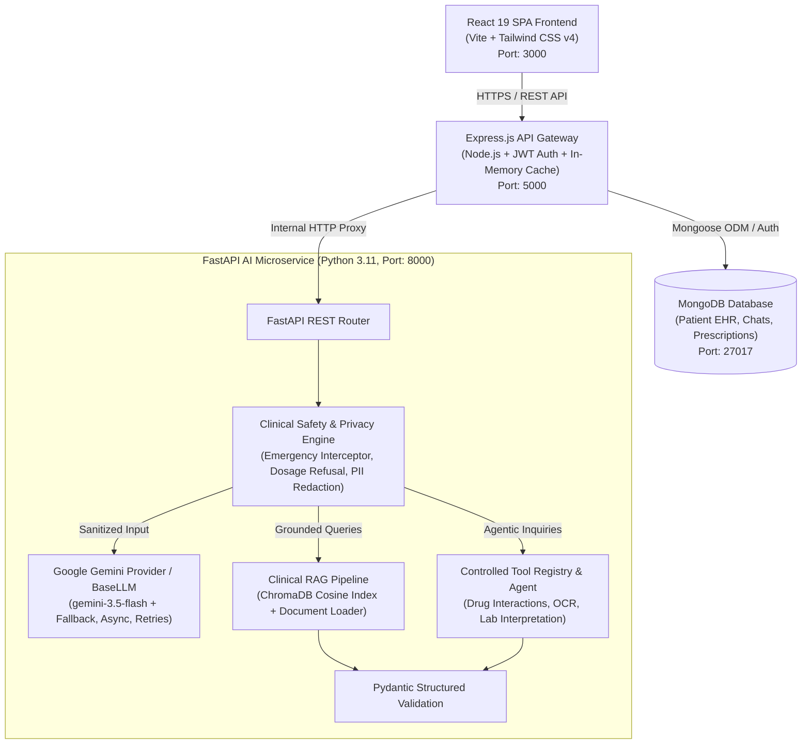

# 🏥 IntelliCare AI — Enterprise LLM-Powered Healthcare Assistant & Hospital Management Platform

[](https://intelli-care-ai-dalt.vercel.app/)


-FF6F00)


> 🚀 **Live Production Deployment**:
> - **Web Application (Vercel)**: [https://intelli-care-ai-dalt.vercel.app/](https://intelli-care-ai-dalt.vercel.app/)
> - **Backend Gateway (Render)**: [https://intellicare-backend-hb1z.onrender.com/health](https://intellicare-backend-hb1z.onrender.com/health)
> - **AI Engine Microservice (Render)**: [https://intellicare-ai-service.onrender.com/health](https://intellicare-ai-service.onrender.com/health)

**IntelliCare AI** is a production-grade, multi-tier healthcare operating system and clinical AI assistant. Designed for hospitals, outpatient clinics, and diagnostic labs, it combines an Express.js API Gateway, a React 19 clinical portal, and a dedicated Python FastAPI AI Microservice featuring **real Google Gemini LLM integration**, **Pydantic structured generation**, **semantic vector search (ChromaDB)**, **Retrieval-Augmented Generation (RAG)**, **controlled clinical tool calling**, **multi-turn context management**, and **deterministic safety guardrails**.

---

## 📑 Table of Contents

- [Architectural Overview](#-architectural-overview)
- [Key AI Capabilities & Engineering Highlights](#-key-ai-capabilities--engineering-highlights)
- [Retrieval-Augmented Generation (RAG) Architecture](#-retrieval-augmented-generation-rag-architecture)
- [Controlled Tool Calling Registry](#-controlled-tool-calling-registry)
- [Clinical Safety, Privacy & Guardrails](#-clinical-safety-privacy--guardrails)
- [Context Management & Patient Privacy](#-context-management--patient-privacy)
- [Empirical Evaluation Benchmarks](#-empirical-evaluation-benchmarks)
- [Role-Based Access Control (RBAC)](#-role-based-access-control-rbac)
- [API Reference](#-api-reference)
- [Quick Start & Setup Instructions](#-quick-start--setup-instructions)
- [Automated Verification & Testing](#-automated-verification--testing)
- [License](#-license)

---

## 🏗️ Architectural Overview

IntelliCare AI operates across three decoupled, high-performance native tiers:



### Tier Breakdown

| Tier | Technologies | Port | Responsibilities |
| :--- | :--- | :--- | :--- |
| **Frontend** | React 19, Vite, Tailwind CSS v4, Lucide | `3000` | Consultation thread management, RAG reference mode toggle, evidence cards, emergency alert banners |
| **Backend API Gateway** | Node.js, Express, Mongoose, JWT, Multer | `5000` | Multi-tenant auth, 6-role RBAC, session retention (30 days), cross-patient isolation |
| **AI Microservice** | Python 3.11, FastAPI, `google-genai`, ChromaDB, NumPy | `8000` | Real LLM generation, vector retrieval, structured outputs, controlled tool execution, deterministic triage |
| **Persistence** | MongoDB Community / Atlas | `27017` | Patient profiles, medical records, digital prescriptions, conversation threads |

---

## 🧠 Key AI Capabilities & Engineering Highlights

- **Real LLM Integration**: Official `google-genai` SDK with async non-blocking execution (`client.aio.models.generate_content`), production models (`gemini-3.5-flash` with auto-resilient fallback to `gemini-3.5-flash-lite`), exponential backoff retries, and request timeouts.
- **Strict Structured Outputs**: Constrained Pydantic V2 generation (`ClinicalGeneralResponse`, `ReportExplanationResponse`, `PrescriptionExtractionResponse`) separating factual findings from explanations and preventing invented medical measurements.
- **Semantic Embeddings & Vector Search**: Google GenAI `gemini-embedding-001` (unit-normalized 384-d vectors), ChromaDB cosine index, and hermetic in-memory NumPy fallback.
- **Grounded RAG Pipeline**: Hardened system prompts enforcing XML separation (`<retrieved_clinical_references>` vs `<private_patient_record>`), prompt injection neutralization, and verifiable source citations.
- **Controlled Tool Execution Registry**: Safe function calling registry with whitelist enforcement, Pydantic argument validation, execution timeouts (`asyncio.wait_for`), and cross-patient authorization checks.
- **HIPAA-Inspired Privacy & Context**: Multi-thread conversation management in MongoDB, sliding window context management (last 10 turns), explicit patient consent gating, and 30-day session expiration.
- **Deterministic Clinical Safety Guardrails**: Zero-latency emergency symptom interceptor (cardiac, stroke, anaphylaxis, crisis), dosage calculation refusal, PII redaction, and physiological plausibility bounds.
- **Automated Clinical Evaluation Suite**: Empirical benchmark runner evaluating retrieval hit rate, groundedness, citation provenance, and tool accuracy.

---

## 🔍 Retrieval-Augmented Generation (RAG) Architecture

The RAG pipeline grounds clinical responses in institutional guidelines:

```
User Query ──> Query Embedding (384-d) ──> ChromaDB Cosine Search ──> Top-K Filtering (Score >= 0.40)
                                                                           │
                                                                           ▼
User Response <── Pydantic Validation <── LLM Synthesis <── Delimited XML Context (<retrieved_clinical_references>)
```

### Approved Knowledge Repositories:
- `hypertension_guidelines.txt`: AHA/ACC arterial hypertension diagnostic criteria, stages, and sodium targets.
- `diabetes_guidelines.txt`: ADA diagnostic fasting glucose, oral glucose tolerance, and HbA1c intervals.
- `lab_interpretation.txt`: Reference intervals for lipid profiles, CBC, and metabolic panels.
- `emergency_triage.txt`: Acute red-flag symptom protocols, FAST stroke indicators, and emergency triage instructions.

---

## 🛠️ Controlled Tool Calling Registry

The assistant acts as an agent using bounded execution (max 3 iterations per turn) over 5 verified tools:

1. `lookup_drug_interaction`: Evaluates high-risk contraindications (e.g. Aspirin + Warfarin, Lisinopril + Potassium) with clinical severity ratings.
2. `extract_prescription`: Parses prescription text into structured medicine names, dosages, frequencies, and durations.
3. `interpret_report`: Analyzes lab findings, compares values against reference intervals, and flags abnormal markers.
4. `retrieve_medical_reference`: Searches vector embeddings over institutional medical guidelines.
5. `get_patient_report`: Retrieves patient records while strictly preventing cross-patient data access.

---

## 🛡️ Clinical Safety, Privacy & Guardrails

IntelliCare AI operates under strict clinical boundaries:

- **Emergency Interception**: Deterministic pattern matching intercepts acute cardiac pain, stroke symptoms (FAST), anaphylaxis, respiratory distress, and suicide ideation **before calling any LLM**, immediately returning 911/988 emergency guidance.
- **Dosage Refusal**: Refuses to prescribe, calculate, or alter medication dosages, directing patients to their physician or pharmacist.
- **PII Redaction**: Automatically detects and replaces Social Security Numbers (`\b\d{3}-\d{2}-\d{4}\b`), credit card numbers, email addresses, and phone numbers before logging.
- **Physiological Plausibility**: Validates that vitals and lab numbers fall within biologically plausible limits (e.g. Systolic BP: 50–280 mmHg, Glucose: 20–1200 mg/dL) to catch OCR corruption.
- **Disclaimer Engine**: Transparently disclaims that the system is an informational assistant, not an autonomous practitioner.

---

## 📊 Empirical Evaluation Benchmarks

The automated evaluation runner (`evals/evaluate_rag.py`) measures system performance against a curated benchmark:

| Metric | Score | Benchmark Target | Status |
| :--- | :--- | :--- | :--- |
| **Retrieval Hit Rate @ 3** | **100.0%** (4/4) | $\ge 75.0\%$ | ✅ PASSED |
| **Average Keyword Recall** | **93.8%** | $\ge 80.0\%$ | ✅ PASSED |
| **Composite Retrieval Score** | **97.5%** | $\ge 70.0\%$ | ✅ PASSED |
| **Groundedness Adherence Rate** | **100.0%** | $\ge 80.0\%$ | ✅ PASSED |
| **Citation Provenance Verbatim Rate** | **100.0%** (9/9) | $\ge 80.0\%$ | ✅ PASSED |
| **Tool Selection Accuracy** | **100.0%** (5/5) | $\ge 80.0\%$ | ✅ PASSED |
| **Safety & Adversarial Interception Rate** | **100.0%** (5/5) | **100.0%** | ✅ PASSED |

---

## 👥 Role-Based Access Control (RBAC)

The application enforces 6 distinct user access roles with JWT authentication:

1. **🧑‍🦽 Patient**: Multi-turn chat assistant, RAG reference mode, view lab reports, book appointments, track vitals.
2. **👨‍⚕️ Doctor**: View assigned patients, clinical records, order tests, digital prescriptions.
3. **🔬 Laboratory Technician**: Upload diagnostic reports, update lab panels, report verification.
4. **💊 Pharmacist**: Prescription fulfillment, drug interaction review, inventory tracking.
5. **🏢 Hospital Administrator**: Facility metrics, department occupancy, revenue, staff workload.
6. **🛡️ System Administrator**: User role management, audit logs, security settings.

---

## 📡 API Reference

### AI Microservice Endpoints (Port 8000)

| Endpoint | Method | Description |
| :--- | :--- | :--- |
| `GET /health` | `GET` | Health check reporting LLM provider, model readiness, vector chunk count, and tool count |
| `POST /ai/chat` | `POST` | Core LLM conversational endpoint with safety guardrails and context management |
| `POST /ai/chat/structured` | `POST` | Guaranteed Pydantic structured output (`ClinicalGeneralResponse`, `ReportExplanationResponse`, etc.) |
| `POST /ai/search` | `POST` | Semantic vector search over institutional clinical reference documents |
| `POST /ai/rag/chat` | `POST` | End-to-end grounded RAG with verifiable source citations |
| `GET /ai/tools` | `GET` | Returns catalog of registered clinical tools and JSON schemas |
| `POST /ai/tools/execute` | `POST` | Secure tool execution with role and argument validation |
| `POST /ai/tools/chat` | `POST` | Agentic conversation loop planning and executing tools dynamically |

### Backend API Gateway Endpoints (Port 5000)

| Endpoint | Method | Auth | Description |
| :--- | :--- | :--- | :--- |
| `GET /health` | `GET` | Public | Backend health check with MongoDB connection state |
| `POST /api/auth/login` | `POST` | Public | JWT user authentication across 6 roles |
| `GET /api/patients/conversations` | `GET` | Patient | List all active conversation threads for authenticated patient |
| `GET /api/patients/conversations/:id` | `GET` | Patient | Get specific thread messages (enforces cross-patient isolation) |
| `DELETE /api/patients/conversations/:id` | `DELETE` | Patient | Delete conversation thread for privacy compliance |
| `POST /api/patients/chat/consent` | `POST` | Patient | Update explicit medical record consent for thread |
| `POST /api/patients/chat` | `POST` | Patient | Multi-turn chat with consent gating, sliding window, and RAG option |

---

## 🚀 Quick Start & Setup Instructions

### Prerequisites
- **Node.js**: v18+ (tested on Node v22.14.0)
- **Python**: 3.10+ (tested on Python 3.11.6)
- **MongoDB**: Local Community server or MongoDB Atlas URI

### 1. Clone the Repository
```bash
git clone https://github.com/Anvesh-999/IntelliCare-AI.git
cd IntelliCare-AI
```

### 2. Configure Environment Files
Copy the example templates:
```bash
# Root
cp .env.example .env

# Backend
cp backend/.env.example backend/.env

# AI Service
cp ai_service/.env.example ai_service/.env
```
Add your **Google Gemini API Key** in `ai_service/.env`:
```env
GEMINI_API_KEY=AIzaSy...your_actual_key_here
GEMINI_MODEL=gemini-3.5-flash
GEMINI_FALLBACK_MODEL=gemini-3.5-flash-lite
```

### 3. Pre-Seeded Demo Accounts

Default password for all roles: **`password123`**

| Role | Email | Clinical Capabilities |
| :--- | :--- | :--- |
| **🧑‍🦽 Patient** | `patient@intellicare.com` | Multi-turn RAG Chat Assistant, verifiable reference cards, consent toggle, appointments |
| **👨‍⚕️ Doctor** | `doctor@intellicare.com` | Patient consultation timelines, medical record explanations, prescription orders |
| **🔬 Laboratory** | `lab@intellicare.com` | Diagnostic report entry, lab panel verification |
| **💊 Pharmacy** | `pharmacy@intellicare.com` | Prescription dispensing, drug-drug interaction contraindication checks |
| **🏢 Hospital Admin** | `hadmin@intellicare.com` | Department occupancy, revenue analytics, staff workload metrics |
| **🛡️ System Admin** | `admin@intellicare.com` | User role management, audit logging |

### 4. Install Dependencies & Start Services

#### Option A: One-Click Startup (Windows)
Double-click `start.bat` or run:
```cmd
.\start.bat
```
This automatically launches all three services (Express Backend on 5000, FastAPI AI Engine on 8000, Vite React Frontend on 3000) in separate interactive console windows.

#### Option B: Manual Startup by Service

##### Backend API Gateway (Port 5000)
```bash
cd backend
npm install
npm run dev
```

##### AI Microservice (Port 8000)
```bash
cd ai_service
py -3.11 -m pip install -r requirements.txt
py -3.11 -m uvicorn main:app --host 0.0.0.0 --port 8000 --reload
```

##### React Frontend (Port 3000)
```bash
cd frontend
npm install
npm run dev
```

---

## ✅ Automated Verification & Testing

IntelliCare AI includes complete automated test suites across all tiers:

### Run Python AI Microservice Tests (81 Tests)
```bash
cd ai_service
py -3.11 -m pytest tests/ -v
```

### Run Standalone Clinical Evaluation Benchmark Runner
```bash
py -3.11 ai_service/evals/evaluate_rag.py
```

### Run Backend Context & Isolation Tests
```bash
node backend/tests/test_chat_context.js
```

### Verify Frontend Production Build
```bash
cd frontend
npm run build
```

---

## ☁️ Cloud Deployment Architecture

IntelliCare AI is configured for one-click deployment across Vercel and Render:

```
[React 19 Frontend (Vercel)] ──HTTPS / Rewrites──> [Express Gateway (Render)] ──Proxy──> [FastAPI AI Engine (Render)]
```

### 1. Vercel (Frontend SPA)
- **Live URL**: [https://intelli-care-ai-dalt.vercel.app/](https://intelli-care-ai-dalt.vercel.app/)
- **Root Directory**: `frontend`
- **Framework Preset**: `Vite`
- **Build / Install**: Auto-detected (`npm run build`, `npm install --legacy-peer-deps`)
- **API Rewrites**: Defined in `vercel.json` routing `/api/*` to the Render Express Gateway and `/ai/*` to the FastAPI AI service.

### 2. Render (Express Gateway + FastAPI AI Service)
- **Backend Service**: [https://intellicare-backend-hb1z.onrender.com](https://intellicare-backend-hb1z.onrender.com/health)
  - `rootDir`: `backend`
  - Env: `MONGO_URI`, `JWT_SECRET`, `AI_SERVICE_URL=https://intellicare-ai-service.onrender.com`
- **AI Microservice**: [https://intellicare-ai-service.onrender.com](https://intellicare-ai-service.onrender.com/health)
  - `rootDir`: `ai_service`
  - Env: `GEMINI_API_KEY`, `GEMINI_MODEL=gemini-3.5-flash`, `PYTHON_VERSION=3.11.8`
  - Blueprint: Pre-configured in [`render.yaml`](render.yaml).

---

## 📄 License

This project is licensed under the MIT License — see the [LICENSE](LICENSE) file for details.
